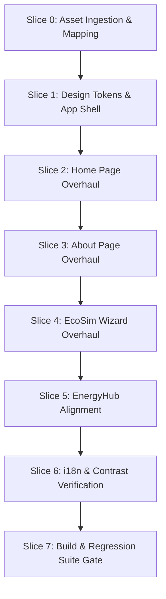

# Megaplan & Style Guide: LUMI Revised UI Layout Modernization
**SWE-2 Autonomous Agent Execution Specification for Devin AI Agent**

---

## Executive Briefing for Devin AI Agent

You are tasked with executing the **LUMI Revised UI Modernization**. Your objective is to upgrade the layout, aesthetic quality, and component architecture across the LUMI web application to match the visual mockups in the revised UI design specifications (`LUMI-Revised UI-format`) using the official graphics from `REVISED_UI-ASSETS`.

### Core Objective
Transform the front-end surfaces (**Navbar & App Shell**, **Home Page**, **About Page**, and the **EcoSim 6-Step Simulation Wizard**) from the current text-heavy/minimal layout into the rich, approachable, illustrated, and human-centered design specified in the revised mockups, **without breaking existing functionality, backend API contracts, calculations, routing, i18n parity, or the test suite**.

### Non-Negotiables & Guardrails
1. **Zero Regression Guarantee:**
   - **Do NOT break API integration:** Keep all service calls in `src/services/apiClient.js`, `src/services/energyhub.js`, and `src/services/savedLocations.js` intact.
   - **Do NOT alter simulation formulas:** `src/utils/ecosimAnalysis.js`, `src/utils/municipalities.js`, and `src/utils/ecosimPdf.js` must remain numerically identical.
   - **Do NOT break Auth & Session state:** Supabase auth, user context, profile hooks (`useAuth`), and JWT flows must function seamlessly.
   - **Keep all 77 Vitest tests passing:** Run `npm.cmd run test:run --prefix react-frontend` after every slice.
2. **Strict i18n Parity (English & Filipino):**
   - Every user-facing string must exist in both `src/i18n/en.json` and `src/i18n/fil.json`.
   - Never hardcode user-facing English strings directly in JSX without corresponding keys in both locales.
3. **Brand & Impeccable Design Token Integrity:**
   - Anchor all green tones to the **Lumi Green** family (`#2e5f2b`, hue ~108–142).
   - **Gold Reserve Rule:** Solar Gold (`#f6d96a`) is strictly reserved for solar data and high-value accents (≤1–2 per viewport). Never use gold as general interface chrome.
   - **WCAG AA Contrast Gate:** Maintain ≥ 4.5:1 contrast for normal text and ≥ 3.0:1 for large text/icons in both **Light Mode** and **Dark Mode**.
   - **Flat-By-Default Elevation:** Surfaces carry minimal shadow (`shadow-sm`) at rest; dynamic elevation occurs only on hover/focus (`shadow-md`, `shadow-lg`, `shadow-primary`).

---

## 1. Visual Style Guide & Design System

### 1.1 Creative North Star: "The Municipal Energy Advisor"
LUMI is designed as a knowledgeable, trustworthy local guide standing beside Filipino homeowners. The visual aesthetic is warm, optimistic, approachable, and distinctly rooted in the Philippine ecological landscape. Surfaces are clean, soft-cornered, and uncluttered, pairing clear data visualizations with helpful contextual illustrations.

### 1.2 Color Architecture & Design Tokens

LUMI uses CSS custom properties defined in `react-frontend/src/styles/globals.css`. All tokens are rendered via HSL values:

#### Light Mode Palette (Default)
| Token | HSL Value | Hex Equivalent | Usage / Intent |
|---|---|---|---|
| `--primary` | `hsl(122 35% 30%)` | `#2e5f2b` | **Lumi Green**: Primary action buttons, active nav pills, key icons |
| `--ring` | `hsl(122 35% 35%)` | `#3b6e38` | Keyboard focus ring (mandatory WCAG AA accessibility) |
| `--foreground` | `hsl(120 50% 10%)` | `#0f260d` | **Forest Ink**: High-contrast body and heading typography |
| `--background` | `hsl(120 30% 97%)` | `#f4fbf4` | **Pale Meadow**: Soft, slightly green-tinted page canvas |
| `--card` | `hsl(0 0% 100%)` | `#ffffff` | **Card White**: Crisp elevated surfaces, wizard panels, modals |
| `--muted` | `hsl(120 35% 93%)` | `#ebf6eb` | **Mist**: Subtle input fills, quiet container backdrops |
| `--muted-foreground` | `hsl(120 32% 22%)` | `#264a26` | Deep green-charcoal secondary text (guarantees ≥ 7:1 contrast) |
| `--secondary` | `hsl(120 45% 90%)` | `#dff6df` | **Meadow Mist**: Secondary button fills, light tag pills |
| `--border` | `hsl(120 25% 83%)` | `#c6e0c6` | **Leaf Border**: Soft borders on cards, inputs, and dividers |
| `--accent` | `hsl(45 90% 65%)` | `#f6d96a` | **Solar Gold**: Solar energy references, highlight accents |
| `--brand-dark` | `hsl(120 50% 15%)` | `#133913` | **Forest Deep**: Dark banner backgrounds (How it Works, Beneficiaries) |

#### Dark Mode Palette (`.dark`)
| Token | HSL Value | Hex Equivalent | Usage / Intent |
|---|---|---|---|
| `--background` | `hsl(120 40% 2%)` | `#030703` | Forest obsidian background |
| `--foreground` | `hsl(116 37% 92%)` | `#e4f2e3` | Pale leaf high-contrast text |
| `--card` | `hsl(120 30% 8%)` | `#0e180d` | Raised dark surface |
| `--primary` | `hsl(117 62% 54%)` | `#48d241` | Luminous vibrant green for dark contrast |
| `--border` | `hsl(120 25% 18%)` | `#223321` | Deep subtle container outline |
| `--muted-foreground`| `hsl(116 20% 70%)` | `#a4bca3` | Legible secondary text on dark surfaces |

#### Semantic Renewable Colors
- **Solar:** `var(--chart-solar)` / Gold `#ffe175` / Accent `#f6d96a`
- **Wind:** `var(--chart-wind)` / Wind Green `#64be60`
- **Hydro:** `var(--chart-hydro)` / Deep Lumi Green `#2e5f2b`
- **Geothermal:** `var(--chart-geothermal)` / Ember `#cb6b0b`

### 1.3 Typography Hierarchy
- **Base Root Size:** `17px` (`html { font-size: 17px; }`)
- **Display Hero Headings:** `font-extrabold` (800), `tracking-tight`, `text-3xl sm:text-4xl md:text-5xl`
- **Section Titles:** `font-bold` (700) or `font-semibold` (600), `text-2xl sm:text-3xl`
- **Card Titles:** `font-semibold` (600), `text-lg sm:text-xl`
- **Body Prose:** `font-normal` (400), `text-base` (or `text-sm` for compact descriptions), `leading-relaxed`
- **Microcopy Floor:** Never use text smaller than `12px` (`text-xs`). All form helper labels and badge text must be at least `text-xs font-medium` with adequate contrast.

### 1.4 Shapes, Borders & Elevation
- **Pills / Capsules:** `rounded-full` for all navigation buttons, badges, status indicators, and preset filter chips.
- **Card Surfaces:** `rounded-2xl` (16px) or `rounded-3xl` (24px) with `border border-border/70` and `bg-card`.
- **Form Controls:** `rounded-xl` or `rounded-lg` with `h-11` or `h-10`, soft border, and clear focus ring `focus-visible:ring-2 focus-visible:ring-ring`.
- **Elevation System:**
  - Resting cards: `shadow-sm`
  - Interactive cards (on hover): `hover:shadow-md hover:border-primary/40 transition-all duration-200`
  - Featured / Accent cards: `shadow-lg shadow-primary/10`

---

## 2. Asset Catalog & Deployment Mapping

All official illustrations from `REVISED_UI-ASSETS` must be copied to `react-frontend/public/assets/revised/` to allow Vite and standard `` tags to resolve them instantly.

### Recommended Asset Directory Structure
```
react-frontend/public/assets/revised/
├── home/
│   ├── header-graphic.png           <- REVISED_UI-ASSETS/HOME/Header Graphic.png
│   ├── energyhub-graphic.png        <- REVISED_UI-ASSETS/HOME/EnergyHub Graphic.png
│   ├── ecosim-graphic.png           <- REVISED_UI-ASSETS/HOME/EcoSim Graphic.png
│   ├── clear-explanations.png       <- REVISED_UI-ASSETS/HOME/Clear Explanations Graphic.png
│   ├── solar-energy.png             <- REVISED_UI-ASSETS/HOME/Solar Energy Graphic.png
│   ├── wind-energy.png              <- REVISED_UI-ASSETS/HOME/Wind Energy Graphic.png
│   ├── hydro-energy.png             <- REVISED_UI-ASSETS/HOME/Hydro Energy Graphic.png
│   └── sunny-family-solar-home.png  <- REVISED_UI-ASSETS/HOME/Sunny Family Solar Home.png
├── about/
│   ├── header-family.png            <- REVISED_UI-ASSETS/ABOUT/Header Family Pic.png
│   ├── why-lumi-created.png         <- REVISED_UI-ASSETS/ABOUT/Why LUMI Was Created.png
│   ├── mission.png                  <- REVISED_UI-ASSETS/ABOUT/Mission.png
│   ├── vision.png                   <- REVISED_UI-ASSETS/ABOUT/Vision.png
│   ├── households.png               <- REVISED_UI-ASSETS/ABOUT/Households.png
│   ├── doe.png                      <- REVISED_UI-ASSETS/ABOUT/DOE.png
│   ├── denr.png                     <- REVISED_UI-ASSETS/ABOUT/DENR.png
│   ├── ngcp.png                     <- REVISED_UI-ASSETS/ABOUT/NGCP.png
│   ├── future-researchers.png       <- REVISED_UI-ASSETS/ABOUT/Future Researchers and Dev.png
│   ├── python-logo.png              <- REVISED_UI-ASSETS/ABOUT/python-logo.png
│   ├── fastapi-logo.png             <- REVISED_UI-ASSETS/ABOUT/fastapi-logo.png
│   ├── react-logo.png               <- REVISED_UI-ASSETS/ABOUT/react-logo.png
│   ├── postgresql-logo.png          <- REVISED_UI-ASSETS/ABOUT/postgresql-logo.png
│   └── ready-to-explore.png         <- REVISED_UI-ASSETS/ABOUT/Ready to Explore LUMI.png
└── ecosim/
    └── header-family-ecosim.png     <- REVISED_UI-ASSETS/ECOSIM/Header-fam pic-ecosim.png
```

---

## 3. Screen-by-Screen Layout Specifications

### 3.1 App Shell & Navbar (`Navbar.jsx`)
*Visual Reference: Top navbar of `HOME.jpg`, `ABOUT.jpg`, and `ECOSIM-1.jpg`*

#### Layout & Components:
1. **Logo:** Brand logo (`/logo.png` or `lumi-logo.png`) rendered at `h-10 sm:h-12 w-auto object-contain`.
2. **Nav Links Pill Container:**
   - Active link rendered as solid dark green pill: `bg-primary text-primary-foreground font-semibold px-4 py-1.5 rounded-full shadow-sm`.
   - Inactive links rendered with subtle hover: `text-foreground/80 hover:text-primary hover:bg-muted/60 px-3 py-1.5 rounded-full transition-colors`.
   - Items: **Home** (`/`), **About** (`/about`), **EcoSim** (`/ecosim`), **EnergyHub** (`/energyhub`).
3. **Right Controls:**
   - **Divider:** Subtle vertical rule `h-6 w-px bg-border`.
   - **User Capsule:** If logged in, display rounded capsule `flex items-center gap-2 px-3 py-1 bg-muted/50 rounded-full border border-border/60` showing the user avatar circle + username label. If guest, show clean "Sign in" / "Register" pills.
   - **Language Toggle:** Pill group with `EN` and `FIL` buttons. Active language styled with `bg-primary text-white rounded-full px-2.5 py-1 text-xs font-semibold`.
   - **Dark Mode Toggle:** Compact circular outline button `h-9 w-9 rounded-full border border-border/80 flex items-center justify-center`.

---

### 3.2 Home Page (`Home.jsx`)
*Visual Reference: `c:\Users\Admin\Downloads\LUMI-Revised UI-format\HOME.jpg`*

#### 1. Hero Section (Two-Column Asymmetric Grid)
- **Container:** `max-w-7xl mx-auto px-4 sm:px-6 lg:px-8 py-10 sm:py-16 grid grid-cols-1 lg:grid-cols-12 gap-8 items-center`
- **Left Column (col-span-7):**
  - **Headline:** `text-3xl sm:text-5xl lg:text-6xl font-extrabold tracking-tight text-foreground leading-[1.15]`
    - Text: "Find the Best Renewable Energy Option for"
    - Highlight span: `<span className="text-primary block mt-1">Your Area.</span>`
  - **Subtitle:** `mt-5 text-base sm:text-lg text-muted-foreground leading-relaxed max-w-xl`
    - "LUMI helps you compare solar, wind, and hydro energy based on your location, estimated costs, and potential savings."
  - **Action Button Row:** `mt-8 flex flex-wrap items-center gap-4`
    - **Primary CTA:** `<Button asChild className="h-12 px-6 rounded-full bg-primary hover:bg-primary/90 text-primary-foreground font-medium text-base shadow-sm gap-2">`
      - Icon: `<Zap className="h-4 w-4 fill-current" />`
      - Text: "Compare Energy Options" (Links to `/ecosim`)
    - **Secondary CTA:** `<Button asChild variant="outline" className="h-12 px-6 rounded-full border-border bg-muted/40 hover:bg-muted text-foreground font-medium text-base gap-2">`
      - Icon: `<BarChart3 className="h-4 w-4 text-primary" />`
      - Text: "Explore Climate Data" (Links to `/energyhub`)
- **Right Column (col-span-5):**
  - Card/Container holding `/assets/revised/home/header-graphic.png` with gentle rounded corners (`rounded-3xl`), crisp image rendering, and no harsh drop-shadow.

#### 2. Key Metrics Bar (4 Responsive Metric Cards)
- **Container:** `grid grid-cols-1 sm:grid-cols-2 lg:grid-cols-4 gap-4 max-w-7xl mx-auto px-4 py-8`
- **Card Styling:** `bg-card border border-border/80 rounded-2xl p-5 flex items-start gap-4 hover:shadow-md transition-shadow`
- **Cards Content:**
  1. **Region Coverage:**
     - Icon: Circular badge `bg-primary/10 text-primary p-2.5 rounded-full` with `<MapPin className="h-5 w-5" />`
     - Value: `<div className="text-2xl font-bold text-foreground">17+</div>`
     - Title: `<div className="text-sm font-semibold text-foreground">Philippine Regions Covered</div>`
     - Subtitle: `<div className="text-xs text-muted-foreground">Explore climate and energy information across the country.</div>`
  2. **Energy Options:**
     - Icon: Circular badge with `<Leaf className="h-5 w-5 text-primary" />`
     - Value: `3` | Title: `Solar, Wind & Hydro` | Sub: `Compare three renewable energy options.`
  3. **Data Points:**
     - Icon: Circular badge with `<Database className="h-5 w-5 text-primary" />`
     - Value: `10K+` | Title: `Reliable Data Sources` | Sub: `Information from recognized weather and energy sources.`
  4. **Responsiveness:**
     - Icon: Circular badge with `<Clock className="h-5 w-5 text-primary" />`
     - Value: `Real-time` | Title: `Easy-to-Understand Results` | Sub: `Get simple explanations and recommendations.`

#### 3. Section: "Intelligent Tools for Energy Decisions" (3-Column Feature Cards)
- **Heading:** Centered title + subtitle.
- **Grid:** `grid grid-cols-1 md:grid-cols-3 gap-6 max-w-7xl mx-auto px-4`
- **Card Structure (`rounded-2xl border border-border/80 bg-card p-6 flex flex-col justify-between hover:shadow-md`):**
  - **Top Row:** Title with icon (e.g., `<BarChart3 className="text-primary h-5 w-5" /> EnergyHub`).
  - **Body Text:** Plain-language summary.
  - **Illustration:**
    - Card 1 (EnergyHub): `/assets/revised/home/energyhub-graphic.png`
    - Card 2 (EcoSim): `/assets/revised/home/ecosim-graphic.png`
    - Card 3 (Clear Explanations): `/assets/revised/home/clear-explanations.png`
  - **Bottom Tag Row:** Flex-wrap pills `bg-muted/70 text-foreground text-xs px-2.5 py-1 rounded-full font-medium`.

#### 4. Section: "From Raw Data to Clear Decisions" (Dark Forest Banner)
- **Container:** Full-width container or rounded container `bg-[#133913] text-white rounded-3xl p-8 sm:p-12 max-w-7xl mx-auto my-12`
- **Header:** White title and subtitle centered.
- **Process Pipeline (4 Steps Horizontal on `md+`):**
  - Connected by a subtle white/translucent horizontal line: `border-t border-white/20`.
  - **Step 1:** Icon in rounded square + pill `STEP 1` + "Choose your Location" + "Select your province, city, or region."
  - **Step 2:** Line chart icon + pill `STEP 2` + "Explore Local Conditions" + "See rainfall, sunlight, wind, electricity use, and other information."
  - **Step 3:** Scale icon + pill `STEP 3` + "Compare your Options" + "Compare solar, wind, and hydro based on your area's conditions."
  - **Step 4:** Lightbulb icon + pill `STEP 4` + "See your Recommendation" + "Get an easy-to-understand explanation of which options may suit your area."

#### 5. Section: "Solar, Wind, & Hydro Analysis" (3 Illustrated Cards)
- **Grid:** 3 columns on `lg`, 1 column on mobile.
- **Card 1 (Solar Energy):**
  - Title: `☀️ Solar Energy`
  - Badge: Amber pill `<span className="bg-amber-100 text-amber-800 dark:bg-amber-950 dark:text-amber-300 text-xs font-semibold px-2.5 py-0.5 rounded-full">BEST WHERE THERE IS STRONG SUNLIGHT</span>`
  - Description: Local climate and solar irradiance evaluation.
  - Button: Outline pill button `[📖 View Sources & References]`
  - Image: `/assets/revised/home/solar-energy.png`
- **Card 2 (Wind Energy):**
  - Title: `🍃 Wind Energy`
  - Badge: Teal pill `<span className="bg-emerald-100 text-emerald-800 dark:bg-emerald-950 dark:text-emerald-300 text-xs font-semibold px-2.5 py-0.5 rounded-full">BEST IN LOCATIONS WITH RELIABLE WIND</span>`
  - Button: `[📖 View Sources & References]` | Image: `/assets/revised/home/wind-energy.png`
- **Card 3 (Hydro Energy):**
  - Title: `💧 Hydro Energy`
  - Badge: Blue pill `<span className="bg-blue-100 text-blue-800 dark:bg-blue-950 dark:text-blue-300 text-xs font-semibold px-2.5 py-0.5 rounded-full">BEST NEAR SUITABLE WATER RESOURCES</span>`
  - Button: `[📖 View Sources & References]` | Image: `/assets/revised/home/hydro-energy.png`

#### 6. Bottom CTA Banner
- **Container:** Two-column rounded card `rounded-3xl border border-border/80 bg-muted/30 p-8 sm:p-12 max-w-7xl mx-auto my-12 grid grid-cols-1 lg:grid-cols-12 gap-8 items-center`
- **Left Column (col-span-5):** `/assets/revised/home/sunny-family-solar-home.png`
- **Right Column (col-span-7):**
  - Title: "Find the Right Renewable Energy Option for You"
  - Subtitle: "Choose your location to explore climate information or compare solar, wind, and hydro options."
  - Action Buttons: `⚡ Compare Energy Options` and `📊 Explore Climate Data`

#### 7. Research Citation Bar & Footer
- **Citation Bar:** Compact pill banner: `📖 Our Data & Research: LUMI uses published research and trusted climate and energy data sources.` with a right-aligned `[📖 View Sources & References]` button triggering the citations modal.
- **Footer:** Clean multi-column layout with LUMI logo, mission tagline, site navigation, legal links, and disclaimer text: *"Estimates only — consult a renewable energy provider for precise calculations."*

---

### 3.3 About Page (`About.jsx`)
*Visual Reference: `c:\Users\Admin\Downloads\LUMI-Revised UI-format\ABOUT.jpg`*

#### 1. Hero Section
- **Left Column:** Headline: "Making Renewable Energy Information Easier to Understand", subtitle, action buttons.
- **Right Column:** Hero image `/assets/revised/about/header-family.png` depicting a smiling Filipino family with rooftop solar.

#### 2. 4-Stat Context Row
- **Card 1 (Why LUMI Was Created):** Icon `/assets/revised/about/why-lumi-created.png` + "Access to renewable energy information can be difficult. LUMI brings climate, weather, and location data together in one place..."
- **Card 2 (70.5% Fossil Fuel Share):** 2023 DOE benchmark stat.
- **Card 3 (29.5% Renewable Share):** Clean energy benchmark stat.
- **Card 4 (3 Barriers to Adoption):** High upfront cost, limited awareness, location constraints.

#### 3. Mission & Vision Dual Card Row
- **Mission Card:** Icon `/assets/revised/about/mission.png` + title "Mission" + clear declaration of accessible environmental intelligence.
- **Vision Card:** Icon `/assets/revised/about/vision.png` + title "Vision" + empowering students, households, and leaders.

#### 4. Section: "Who Can Use LUMI?" (Dark Forest Banner with 5 Cards)
- **Container:** Dark green banner (`bg-[#133913] text-white rounded-3xl p-8 max-w-7xl mx-auto my-10`)
- **Header:** White bold centered title "Who Can Use LUMI?"
- **5 Beneficiary Cards Grid (`grid grid-cols-1 sm:grid-cols-2 lg:grid-cols-5 gap-4`):**
  1. **Households & Community:** `/assets/revised/about/households.png`
  2. **Department of Energy (DOE):** `/assets/revised/about/doe.png`
  3. **Department of Environment and Natural Resources (DENR):** `/assets/revised/about/denr.png`
  4. **National Grid Corporation of the Philippines (NGCP):** `/assets/revised/about/ngcp.png`
  5. **Future Researchers & Developers:** `/assets/revised/about/future-researchers.png`

#### 5. Section: "How LUMI is Structured" & "Technology Stack" (Side-by-Side Cards)
- **Grid:** 2 equal columns on `lg`.
- **Left Card: How LUMI is Structured:**
  - 4 module blocks in a row: 📊 EnergyHub, ⚡ EcoSim, 🧠 AI Explanations, 🗄️ Data & Charts.
- **Right Card: Technology Stack:**
  - 5 technology badges with official logos:
    - Python (`/assets/revised/about/python-logo.png`)
    - FastAPI (`/assets/revised/about/fastapi-logo.png`)
    - React (`/assets/revised/about/react-logo.png`)
    - PostgreSQL (`/assets/revised/about/postgresql-logo.png`)
    - AI/ML (Gemini / RAG intelligence icon)

#### 6. Bottom CTA Banner
- Illustrated with `/assets/revised/about/ready-to-explore.png` (dam, wind turbines, solar panels) + "Ready to Explore LUMI?" call to action.

---

### 3.4 EcoSim 6-Step Simulation Wizard (`Ecosim.jsx` & `EcosimWizard.jsx`)
*Visual Reference: `ECOSIM-1.jpg` through `ECOSIM-6.jpg`*

#### 1. Header Banner & Disclaimer
- **Hero Banner:** Left image `/assets/revised/ecosim/header-family-ecosim.png` + Right text:
  - Title: "Find the Best Renewable Energy Option for Your Area."
  - Subtitle: "EcoSim looks at your location, electricity use, and local environmental conditions to help you estimate which renewable energy option may fit you best."
- **Important Disclaimer Bar:**
  - Pill container: `(i) Important: EcoSim estimates are based on regional data and simplified models.` with a clickable link: `Why is this only an estimate?`.

#### 2. Stepper Component (1 to 6)
- **Visual Design:** 6 numbered circles connected by a thin line:
  - **Active Step:** Solid dark green circle `bg-primary text-primary-foreground font-bold h-9 w-9 flex items-center justify-center rounded-full`.
  - **Completed Steps:** Solid dark green circle with white checkmark `<Check className="h-4 w-4 stroke-[3]" />`.
  - **Upcoming Steps:** Light green circle `bg-muted text-muted-foreground font-semibold h-9 w-9`.
  - **Connecting Line:** `h-0.5 w-8 sm:w-12 bg-border` (or `bg-primary` for completed sections).

#### 3. Two-Column Split Architecture
- **Grid:** `grid grid-cols-1 lg:grid-cols-12 gap-8 items-start`
- **Left Column (col-span-8):** The Active Step Card (`rounded-2xl border border-border bg-card p-6 sm:p-8`)
- **Right Column (col-span-4):** Persistent **"Your Inputs"** Summary Sidebar Card

#### 4. Step-by-Step Flow:
- **Step 1 (Location Selection):**
  - Title: `📍 Step 1 of 6` | Subtitle: "Select your city or municipality so we can analyze your local climate and resources."
  - Search Input: Municipality search bar (`SearchableSelect`).
  - Action Button: `🎯 Use my location` (geolocation lookup).
  - Selected Feedback: Pill box showing `Selected: [MUNICIPALITY, PROVINCE]`.
  - Action: `Next ->` (validates that municipality is selected).
- **Step 2 (Electric Bill Details):**
  - Title: `⚡ Step 2 of 6` | Subtitle: "Enter the numbers from your latest electric bill."
  - Bill Helper Callout: Visual guide explaining where to find Actual Consumption (kWh), Current Charges (₱), and Rate (₱/kWh).
  - 3 Inputs:
    - Electricity used this billing period (kWh)
    - Rate per kWh (₱/kWh)
    - Monthly bill (₱)
  - Computed Rate Banner: "Based on your bill, your rate is approximately **₱X.XX per kWh**." with button `[Use this rate]`.
  - Actions: `<- Back` and `Next ->`.
- **Step 3 (Savings Goal):**
  - Title: `🎯 Step 3 of 6` | Subtitle: "Choose how much of your bill renewable energy should cover."
  - Quick Preset Buttons: `25%`, `50%` (active: `bg-primary text-white`), `75%`, `100%`.
  - Range Slider: Smooth slider from "Reduce a little" to "Reduce as much as possible".
- **Step 4 (System & Usage Options):**
  - Title: `⚙️ Step 4 of 6` | Subtitle: "Optional: add a battery, set your roof area, and tell us your daytime usage."
  - Checkbox: `[ ] Add battery storage (hybrid system)`
  - Number Input: `Usable roof area (optional)` in m².
  - Radio Pill Toggle: "Is someone usually home during the day?"
    - `[Out most of the day]` vs `[Mostly home / WFH]`
- **Step 5 (AI Plain-Language Explanation):**
  - Title: `✨ Step 5 of 6` | Subtitle: "Decide if you want a plain-language explanation of the results."
  - Checkbox: `[x] Include simple explanation`
- **Step 6 (Review & Execution):**
  - Title: `📋 Step 6 of 6` | Subtitle: "Review your inputs and run the analysis."
  - 2-Column Review Grid: 8–9 parameter boxes with current values and an `[Edit]` button on each to jump directly back to that step:
    - Location | Consumption | Bill | Rate per kWh | Savings goal | AI analysis | Battery storage | Roof area | Daytime occupancy
  - Actions: `<- Back` and `Run simulation ->` (large primary green button).

#### 5. Persistent "Your Inputs" Summary Card (Right Column)
Styled as a clean vertical card (`rounded-2xl border border-border/80 bg-muted/20 p-6`):
- Header: `📄 Your Inputs`
- Parameter Rows with Icons:
  - 📍 Location: `Selected Name or —`
  - ⚡ Consumption: `350 kWh`
  - ₱ Bill: `₱5,000`
  - 🎯 Savings goal: `50%`
  - 🧠 AI analysis: `Yes / No`
  - 🔋 Battery storage: `Yes / No`
  - ☀️ Daytime occupancy: `Out most of the day / Mostly home`

#### 6. Results Section Integration
When `Run simulation ->` is triggered:
- Render existing `EcosimResults.jsx` below the wizard.
- Preserve the auto-scroll behavior to `#ecosim-result`.
- Keep the Completion Dialog, Save Simulation modal, and PDF export (`downloadEcosimPdf`) fully functional.

---

## 4. Devin AI Agent Execution Megaplan

Execute this overhaul in **7 staged, atomic slices**. Commit each slice independently. Run verification tests after each slice.



---

### Slice 0: Asset Ingestion & Directory Setup
**Goal:** Copy all graphic assets from `c:\Users\Admin\Documents\GitHub\Lumi\REVISED_UI-ASSETS\` into `react-frontend/public/assets/revised/` with clean, web-safe filenames.

**Action Steps:**
1. Create directories:
   - `react-frontend/public/assets/revised/home/`
   - `react-frontend/public/assets/revised/about/`
   - `react-frontend/public/assets/revised/ecosim/`
2. Copy files from `REVISED_UI-ASSETS/HOME/` to `public/assets/revised/home/`:
   - `Header Graphic.png` -> `header-graphic.png` (and keep original name copy for safety)
   - `EnergyHub Graphic.png` -> `energyhub-graphic.png`
   - `EcoSim Graphic.png` -> `ecosim-graphic.png`
   - `Clear Explanations Graphic.png` -> `clear-explanations.png`
   - `Solar Energy Graphic.png` -> `solar-energy.png`
   - `Wind Energy Graphic.png` -> `wind-energy.png`
   - `Hydro Energy Graphic.png` -> `hydro-energy.png`
   - `Sunny Family Solar Home.png` -> `sunny-family-solar-home.png`
3. Copy files from `REVISED_UI-ASSETS/ABOUT/` to `public/assets/revised/about/`:
   - `Header Family Pic.png` -> `header-family.png`
   - `Why LUMI Was Created.png` -> `why-lumi-created.png`
   - `Mission.png` -> `mission.png`
   - `Vision.png` -> `vision.png`
   - `Households.png` -> `households.png`
   - `DOE.png` -> `doe.png`
   - `DENR.png` -> `denr.png`
   - `NGCP.png` -> `ngcp.png`
   - `Future Researchers and Dev.png` -> `future-researchers.png`
   - `Ready to Explore LUMI.png` -> `ready-to-explore.png`
   - `python-logo.png`, `fastapi-logo.png`, `react-logo.png`, `postgresql-logo.png`
4. Copy files from `REVISED_UI-ASSETS/ECOSIM/` to `public/assets/revised/ecosim/`:
   - `Header-fam pic-ecosim.png` -> `header-family-ecosim.png`

**Verification:** Confirm all files exist with `Test-Path` or `ls`.

---

### Slice 1: Design Tokens & App Shell (`Navbar.jsx` & `Footer.jsx`)
**Goal:** Modernize navigation bar into pill-style links, brand logo scaling, profile capsule, and refined footer.

**Target Files:**
- `react-frontend/src/components/layout/Navbar.jsx`
- `react-frontend/src/components/layout/Footer.jsx`

**Key Implementation Requirements:**
- In `Navbar.jsx`:
  - Active nav links use `bg-primary text-primary-foreground font-semibold px-4 py-1.5 rounded-full`.
  - Inactive nav links use `text-foreground/80 hover:text-primary hover:bg-muted/60 px-3 py-1.5 rounded-full`.
  - Language switcher buttons (`EN` / `FIL`) use pill styling.
  - User avatar and username render inside a compact rounded capsule.
  - Mobile drawer navigation retains full route coverage and auth triggers.
- In `Footer.jsx`:
  - Align layout with the bottom footer from the mockups, keeping all legal links and disclaimer text.

**Verification:**
```bash
npm.cmd run test:run --prefix react-frontend
```

---

### Slice 2: Home Page Overhaul (`Home.jsx`)
**Goal:** Transform `Home.jsx` into the revised layout shown in `HOME.jpg`.

**Target File:**
- `react-frontend/src/pages/Home.jsx`

**Key Implementation Requirements:**
1. **Hero Section:** Two-column grid with bold headline, subtitle, dual pill buttons (`⚡ Compare Energy Options` and `📊 Explore Climate Data`), and `/assets/revised/home/header-graphic.png`.
2. **Metrics Bar:** 4 cards (17+ Regions, 3 Renewable Options, 10K+ Reliable Data, Real-time Results) with circular icon badges.
3. **Intelligent Tools Section:** 3 feature cards with `energyhub-graphic.png`, `ecosim-graphic.png`, and `clear-explanations.png`, each with bottom pill tags.
4. **How It Works Section:** Dark forest container (`bg-[#133913] text-white rounded-3xl`) with 4 horizontal process steps (STEP 1 to STEP 4) connected by subtle lines.
5. **Renewable Analysis Section:** 3 cards for Solar, Wind, and Hydro with semantic colored badges (`BEST WHERE...`), descriptions, `[📖 View Sources & References]` button, and matching illustrated graphics.
6. **Bottom CTA Banner:** Two-column card featuring `sunny-family-solar-home.png` and dual action buttons.
7. **Citation Bar:** Sticky or bottom pill bar linking to research sources.

**Verification:**
```bash
npm.cmd run test:run --prefix react-frontend
```

---

### Slice 3: About Page Overhaul (`About.jsx`)
**Goal:** Transform `About.jsx` into the revised layout shown in `ABOUT.jpg`.

**Target File:**
- `react-frontend/src/pages/About.jsx`

**Key Implementation Requirements:**
1. **Hero Section:** Two-column layout with `header-family.png`.
2. **Context & Metrics Row:** 4 cards: `why-lumi-created.png`, 70.5% fossil fuel share, 29.5% renewable share, 3 barriers to adoption.
3. **Mission & Vision Cards:** Illustrated cards for Mission (`mission.png`) and Vision (`vision.png`).
4. **Beneficiaries Section ("Who Can Use LUMI?"):** Dark forest banner (`bg-[#133913] text-white rounded-3xl`) with 5 cards: Households, DOE, DENR, NGCP, Future Researchers.
5. **System Architecture & Tech Stack:** Side-by-side cards:
   - Left: How LUMI is Structured (4 platform modules).
   - Right: Technology Stack (Python, FastAPI, React, PostgreSQL, AI/ML logos).
6. **Bottom CTA Banner:** Illustrated banner with `ready-to-explore.png`.

**Verification:**
```bash
npm.cmd run test:run --prefix react-frontend
```

---

### Slice 4: EcoSim Wizard & Page Layout Overhaul (`Ecosim.jsx` & `EcosimWizard.jsx`)
**Goal:** Implement the revised 6-step layout, header banner, stepper, two-column split, review grid, and persistent "Your Inputs" summary card from `ECOSIM-1.jpg` to `ECOSIM-6.jpg`.

**Target Files:**
- `react-frontend/src/pages/Ecosim.jsx`
- `react-frontend/src/components/ecosim/EcosimWizard.jsx`

**Key Implementation Requirements:**
1. **Header Banner:** Illustrated banner with `header-family-ecosim.png` and subtitle.
2. **Disclaimer Notice Bar:** Pill bar: `(i) Important: EcoSim estimates are based on regional data... Why is this only an estimate?`.
3. **Progress Stepper (1 to 6):**
   - Active: Solid dark green circle.
   - Completed: Dark green circle with white checkmark.
   - Preserves accessible labels: `Step {n} of 6`.
4. **Two-Column Split Layout:**
   - Left column: The active step card (Steps 1–6).
   - Right column: Persistent "Your Inputs" summary card displaying current selections with icons.
5. **Step Details:**
   - Step 1: Search municipality + `Use my location` + selected feedback pill.
   - Step 2: Bill guide callout + 3 inputs (kWh, Rate ₱/kWh, Bill ₱) + computed rate banner with `Use this rate` button.
   - Step 3: Bill reduction presets (25%, 50%, 75%, 100%) + range slider.
   - Step 4: Battery checkbox + roof area input + daytime occupancy radio pills.
   - Step 5: Simple AI explanation toggle.
   - Step 6: 2-column review grid with `[Edit]` buttons jumping to corresponding steps + `Run simulation ->` button.
6. **Preserve Testing Contracts:**
   - Keep text `"Step 1 of 6"`, `"Step 6 of 6"`, and `"Next"` accessible to satisfy `EcosimWizard.test.jsx`.
   - Ensure "Save as PDF" visibility rules in Step 6 / results remain intact.

**Verification:**
```bash
npm.cmd run test:run --prefix react-frontend
```

---

### Slice 5: EnergyHub Alignment & Dark Mode Polish
**Goal:** Harmonize `EnergyHub.jsx` page header and typography with the revised UI format while safeguarding all Leaflet maps, Plotly charts, and API caching.

**Target File:**
- `react-frontend/src/pages/EnergyHub.jsx`

**Key Implementation Requirements:**
- Align page header, breadcrumbs, and filter pills with the revised design language.
- Verify Leaflet map container rendering and Recharts axis legibility.
- Test Dark Mode toggle (`.dark`) across all pages to ensure no unreadable text or low-contrast borders.

**Verification:**
```bash
npm.cmd run test:run --prefix react-frontend
```

---

### Slice 6: Internationalization (i18n) & Accessibility Pass
**Goal:** Ensure complete English (`en.json`) and Filipino (`fil.json`) string parity and verify WCAG AA contrast.

**Target Files:**
- `react-frontend/src/i18n/en.json`
- `react-frontend/src/i18n/fil.json`

**Key Implementation Requirements:**
- Verify that every key referenced in `Home.jsx`, `About.jsx`, and `EcosimWizard.jsx` has an identical key in `fil.json`.
- Run the i18n key parity test:
  ```bash
  npx.cmd vitest run src/__tests__/i18n-keys.test.js
  ```
- Run the theme contrast test:
  ```bash
  npx.cmd vitest run src/__tests__/theme-contrast.test.js
  ```

---

### Slice 7: Automated Verification & Regression Testing Gate
**Goal:** Verify complete project integrity.

**Execution Commands:**
```bash
# 1. Run all unit & integration tests
npm.cmd run test:run --prefix react-frontend

# 2. Run production build
npm.cmd run build --prefix react-frontend
```

**Quality Acceptance Criteria:**
- [x] All 77 unit tests pass with zero errors.
- [x] Production build (`vite build`) completes successfully with zero syntax errors.
- [x] All images render crisply without missing asset 404s.
- [x] Dual-language switching (EN/FIL) functions on every page without missing translation warnings.
- [x] Dark mode toggle renders all components with WCAG AA compliant contrast.
- [x] EcoSim simulation executes, computes valid results, and supports PDF export.

---

## 5. Rollback & Troubleshooting Quick-Reference

- **If Vitest fails on `EcosimWizard.test.jsx`:** Ensure the text `"Step 1 of 6"` and `"Step 6 of 6"` are present as visible text (e.g. `CardTitle` or step label), and button has label `"Next"`.
- **If `theme-contrast.test.js` fails:** Do not lower contrast in `globals.css`. Ensure foreground text stays at `--muted-foreground: 120 32% 22%` or darker on light backgrounds.
- **If an image fails to load:** Verify the path in `public/assets/revised/`. In Vite, files under `public/` are served at the root URL (e.g. `/assets/revised/home/header-graphic.png`).
